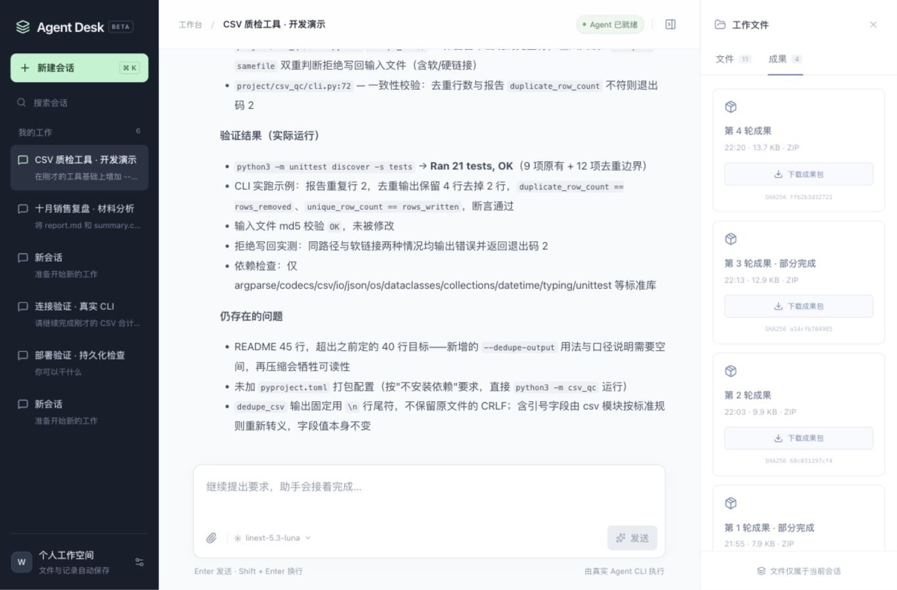
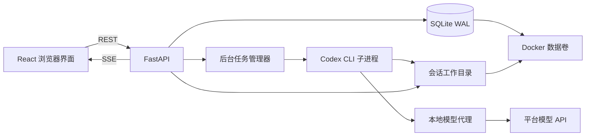

# Agent Desk · 云端 Agent 助手工作台

把 Agent CLI 的文件操作、代码执行与持续对话能力带到浏览器中。面向单用户本机使用，支持多个会话、材料上传、执行记录、成果下载，以及关闭页面后继续工作。



**实现：React + FastAPI + SQLite + 真实 Codex CLI + Docker Compose。** 应用没有模拟模型回复的运行模式；未配置 API 时可浏览界面、管理会话和上传材料，但无法启动 Agent。

## 快速启动

前置条件：Docker Engine / Docker Desktop 与 Docker Compose，能够下载 Docker、npm 和 PyPI 依赖；平台提供支持 Responses 协议与工具调用的模型服务。

```bash
git clone https://github.com/lingyuyang24-cpu/exam.git
cd exam
cp .env.example .env
```

编辑 `.env`：

```dotenv
AGENT_API_KEY=平台提供的临时密钥
AGENT_BASE_URL=https://平台地址/v1
AGENT_MODEL=linext-5.3-luna
```

`AGENT_BASE_URL` 应是 API 前缀，例如 `https://host/v1`；应用会追加 `/responses`，不要填写最终的 `/responses` 路径。具体前缀以平台说明为准。

```bash
docker compose up --build -d
docker compose ps
```

打开 **http://localhost:8080**。配置变化后执行 `docker compose up -d --force-recreate`。

```bash
# 运行日志、健康检查、CLI 版本
docker compose logs --tail=100 app
curl http://localhost:8080/healthz
docker compose exec app codex --version

# 停止服务，保留数据卷
docker compose down

# 再次启动，恢复历史与文件
docker compose up -d
```

`docker compose down -v` 会删除持久化数据，不用于普通停止。

## 使用方式

1. 新建会话，输入任务，或点击首页任务模板。
2. 需要分析材料时，先通过附件按钮上传文本、Markdown、CSV、JSON 或代码文件。
3. 发送任务后，在对话中展开执行记录，查看实际命令、输出和退出码。
4. 右侧“文件”可预览工作文件并单独下载；“成果”提供每轮独立的 ZIP 快照及 SHA256。
5. 在相同会话追加修改意见，CLI 使用原会话 ID 续接，并保留工作目录。
6. 在左侧切换其他会话；最多同时执行两个任务，同一会话只运行一个任务。

Enter 发送，Shift + Enter 换行，Cmd/Ctrl + K 新建会话。点击顶部会话标题可重命名。

**关闭网页不会取消后台任务。** 网页重连后按事件 ID 补发。容器重启会中断正在执行的任务，启动时将其标为“已中断”，保留已产生文件，用户可发送消息继续。它不提供操作系统进程检查点恢复。

## 模型服务与凭据

固定安装 `@openai/codex@0.114.0`。CLI 使用自定义 provider、`codex exec --json`，后续轮次通过 `codex exec resume <session-id>` 续接。模型名从配置读取，不假设固定 OpenAI 模型。

选择这个版本是因为其 Landlock + seccomp 沙箱已在默认 Docker 权限限制下实际验证：可以写入工作目录，拒绝目录外写入。新版本默认 Bubblewrap 需要本环境不支持的用户命名空间。本项目保持非 root、`no-new-privileges` 和 `cap_drop: ALL`，没有为兼容性关闭宿主机或容器安全机制。升级 CLI 时需重新验证沙箱和事件协议。

Codex 自定义 provider 需要 Responses 协议；“OpenAI-compatible”也可能只指 Chat Completions，不能据此判断兼容。接入时应实际验证读文件、执行命令、写结果、第二轮续接四个步骤。官方参考：[非交互模式](https://learn.chatgpt.com/docs/non-interactive-mode)、[provider 配置](https://learn.chatgpt.com/docs/config-file/config-reference)。

本平台仅接受客户端执行的 `function/custom` 工具，因此 CLI 配置显式关闭托管网页搜索（`web_search = "disabled"`），保留本地命令、读写文件等工具。应用记录每次模型请求的工具类型和数量用于兼容性诊断，不记录完整模型请求或凭据。已使用平台模型完成真实 CSV 读取、Python 执行、JSON 生成和独立数字校验。

真实平台密钥仅由服务端持有。每次执行向 CLI 分配短期本地代理 token，内部代理将模型请求转发给配置的上游；CLI 子进程使用环境变量白名单，shell 工具环境进一步排除代理 token。此措施减少密钥意外进入代码和输出的机会，不是抵御同 UID 恶意进程的安全边界。

`.env`、运行数据、IDE 文件与依赖目录均被 Git 和 Docker 构建上下文排除。前端不接收密钥。公开证据仅收录脱敏的演示运行；禁止将临时考试凭据用于应用运行、联调和测试以外的用途。

| 变量 | 默认值 | 说明 |
|---|---|---|
| `AGENT_API_KEY` | 空 | 上游密钥，仅运行时注入 |
| `AGENT_BASE_URL` | 空 | 上游 API 前缀 |
| `AGENT_MODEL` | `linext-5.3-luna` | 平台可用模型 |
| `TASK_TIMEOUT_SECONDS` | `1200` | 单次任务时限；可随时手动停止 |
| `MAX_CONCURRENT_RUNS` | `2` | 全局并发数，允许 1–4 |
| `AGENT_SANDBOX` | `workspace-write` | Codex 沙箱模式 |
| `PORT` | `8080` | Compose 发布到本机的端口 |

API 配置是否存在与是否兼容是不同状态。界面的“Agent 已就绪”表示已安装 CLI 且配置完整，首次实际任务才会验证上游鉴权和协议。

## 架构



- **会话与执行分开**：session 保存工作上下文，一条用户请求创建一个 run。应用记录、CLI 历史、工作文件分别持久化。
- **任务不依赖 HTTP 连接**：消息入库即返回 202，后台调度执行。SSE 只负责观察，断线不终止子进程。
- **SQLite + 单 worker**：适合单用户和少量并发，减少部署组件。使用短事务、WAL、每会话活动任务唯一索引及请求幂等键。不要启动多个 Uvicorn worker。
- **事件可补发**：先入库再发送，递增 ID 用于重连补发和前端去重。仅展示公开回复、计划、命令和文件事件，不展示内部推理。
- **停止整个进程组**：先 SIGTERM，再 SIGKILL，包含工具子进程。正常结束也清理遗留后台子进程。
- **完成与验证分开**：只有成功结束事件和零退出码均满足，run 才标为完成。测试是否通过仍以实际命令记录及独立验证为准。
- **每轮成果快照**：复制本轮结束时的可下载工作成果，记录路径、大小和 SHA256。失败或停止时标注部分成果。打包失败会留下警告，工作文件仍可单独获取。

```text
queued → running → succeeded / failed / cancelled / timed_out / interrupted
```

状态失败不会自动重跑整轮任务，避免重复执行已经发生的文件修改；用户可以检查现有成果后续接。

```text
/data/
├── app.db
└── sessions/<session-id>/
    ├── agent-home/                # CLI 配置、会话历史
    ├── workspace/
    │   ├── AGENTS.md              # 应用提供的工作约定
    │   ├── uploads/               # 材料
    │   ├── project/               # 开发代码
    │   └── outputs/               # 报告与分析输出
    └── artifacts/<run-id>/成果.zip
```

路径访问拒绝绝对路径、隐藏路径、目录穿越和符号链接。Markdown 预览不执行原始 HTML；其他文本以转义文本显示。HTML 成果提供源码预览和下载，不在工作台同源执行。

## 演示与验证

演示材料在 [`demo/inputs`](demo/inputs)，四轮具体提示词和展示顺序在 [`demo/prompts.md`](demo/prompts.md)。输入全部为虚构数据。

- **开发任务**：创建 CSV 数据质量工具并运行 unittest；第二轮增加去重输出，验证原文件不变。
- **日常任务**：上传销售 CSV 和会议记录，生成报告和区域汇总；第二轮改为仅统计已完成订单，重算数字并精简报告。
- **持续工作**：任务执行期间切换会话、刷新页面；完成后重启容器，检查历史与成果。

已完成的真实运行证据：

| 任务 | 结果 | 下载与核验 |
|---|---|---|
| CSV 质检工具 | 9 项生成测试在 Docker 沙箱中独立复测通过 | [代码成果](evidence/real/code_1-artifacts.zip)、[测试输出](evidence/real/code_1-independent-tests.txt) |
| CSV 工具追加去重 | 21 项生成测试及精确去重、原文件保护断言独立通过 | [去重代码成果](evidence/real/code_2-artifacts.zip)、[独立验收](evidence/real/code_2-verification.json)、[测试输出](evidence/real/code_2-independent-tests.txt) |
| 材料分析：全部订单 | 总金额 11920，三区域独立核验通过 | [第一版成果](evidence/real/work_1-artifacts.zip)、[核验](evidence/real/work_1-verification.json) |
| 材料分析：仅已完成 | 总金额 9520，三区域独立核验通过 | [第二版成果](evidence/real/work_2-artifacts.zip)、[核验](evidence/real/work_2-verification.json) |

代码开发与去重追加各有一次达到原 600 秒时限，已有代码、测试输出与部分成果均保留在 `evidence/real/code_*-attempt-1-*`。根据实际平台响应速度，最终默认时限调整为 1200 秒，仍可手动停止。两次均在原会话续接后成功完成核验与交付，历史超时未改写为成功。

四轮最终成功任务、两次保留的超时记录、CLI 续接、多会话并行和重启校验汇总见 [acceptance-summary.json](evidence/real/acceptance-summary.json)。重启后，两会话全部消息、工作文件和 6 份成果 ZIP 的 SHA256 均一致。

独立销售验证脚本不向 Agent 提供预期答案：

```bash
python demo/verify_sales.py
python demo/verify_sales.py --actual /path/to/first-round/summary.csv
python demo/verify_sales.py --completed-only --actual /path/to/second-round/summary.csv
```

运行实际演示后，可以从任务卡下载 JSON 执行记录，从成果面板下载 ZIP。图文演示在 [`evidence/demo-walkthrough.md`](evidence/demo-walkthrough.md)，验证证据说明在 [`evidence/verification.md`](evidence/verification.md)。其中会明确区分真实模型运行和测试替身；不会用测试替身证明模型接入成功。

也可用脚本通过真实应用 API 提交四轮任务、保存执行记录与成果、独立核对销售汇总：

```bash
python scripts/run_demo.py --url http://127.0.0.1:8080
```

该脚本实际调用模型并消耗平台额度，只在配置有效且需要联调演示时运行。默认输出到 Git 忽略的 `evidence/private/latest-demo`，不复用仓库历史证据中的会话 ID；可通过 `--output` 指定其他新目录。相同输出目录会复用任务 ID，避免重复提交；浏览器演示还应展示切换、刷新和后续交流。若任务失败，先检查已保存记录，再显式运行 `--retry-failed` 续接；旧尝试的执行记录和部分成果会保留，不覆盖为成功。

## 开发与测试

需要 Python 3.11+、Node.js 22.12+、pnpm 10 和 Codex CLI。

```bash
python3 -m venv .venv
source .venv/bin/activate
pip install -r requirements-dev.txt
cd frontend
pnpm install --frozen-lockfile
pnpm build
cd ..
python -m uvicorn backend.app:app --host 127.0.0.1 --port 8080
```

本地运行会读取进程环境变量；`.env` 由 Docker Compose 自动读取，本地 Uvicorn 不会自动加载它。凭据请通过受控 shell 环境注入，不要放进命令参数。

```bash
python -m pytest -q
```

自动测试使用 `tests/fake_cli.py` 这个明确标记的进程测试替身，覆盖真实子进程启动、输出解析、续接参数、幂等、并发会话、取消、超时、SSE 补发、路径校验、敏感信息脱敏和重启状态处理。测试替身不会打包进生产镜像。

## 已知限制

- 仅面向单用户可信环境，服务绑定本机；无账号、权限系统或公网部署支持。
- 会话目录是逻辑分离，同容器同 UID 的进程之间没有强租户隔离。不应执行来源不明的恶意项目。
- CLI 沙箱是否可用取决于 Docker 主机的内核与安全配置；不自动关闭沙箱或使用特权容器。
- 只接入 Responses 协议，暂未实现 Chat Completions 协议转换。
- 上传单文件最大 10 MB；材料总量约 100 MB；文件索引最多 1000 个，成果包源文件总量最多 50 MB，超限文件列入 manifest 的 skipped。
- PDF、Office、OCR、在线应用预览、持久后台服务和跨容器进程恢复不在首版范围。
- 工作目录和执行历史不会自动清理；长期使用需要管理数据卷。日志仅做已知密钥和当前 token 脱敏，不代表通用敏感信息识别。
- Agent 输出可能有误。代码与报告需要结合实际测试和源材料验证。

## 常见问题

| 现象 | 处理 |
|---|---|
| 等待 API 配置 | 填写 `.env` 并重建容器实例，不必重新构建镜像 |
| HTTP 401 / 403 | 检查临时凭据是否有效、模型权限是否正确 |
| HTTP 404 / 协议错误 | 核对 API 前缀和 Responses 支持情况 |
| 任务超时 | 查看执行记录，检查模型响应或任务规模，必要时调整时限 |
| 容器重启后任务中断 | 检查已有文件，在原会话发送继续要求 |
| 沙箱启动失败 | 查看 Docker 主机对 Codex 沙箱的支持，保留错误证据后调整运行环境 |
| 前端能打开但接口异常 | 使用本机地址访问，避免跨站代理；查看 `/healthz` 与容器日志 |

## 源码导航

`backend/app.py`：REST、SSE、文件与模型代理；`runner.py`：CLI 和任务生命周期；`db.py`：持久化事务；`files.py`：路径校验与成果快照；`frontend/src/main.jsx`：工作台交互；`tests/`：确定性验证。
