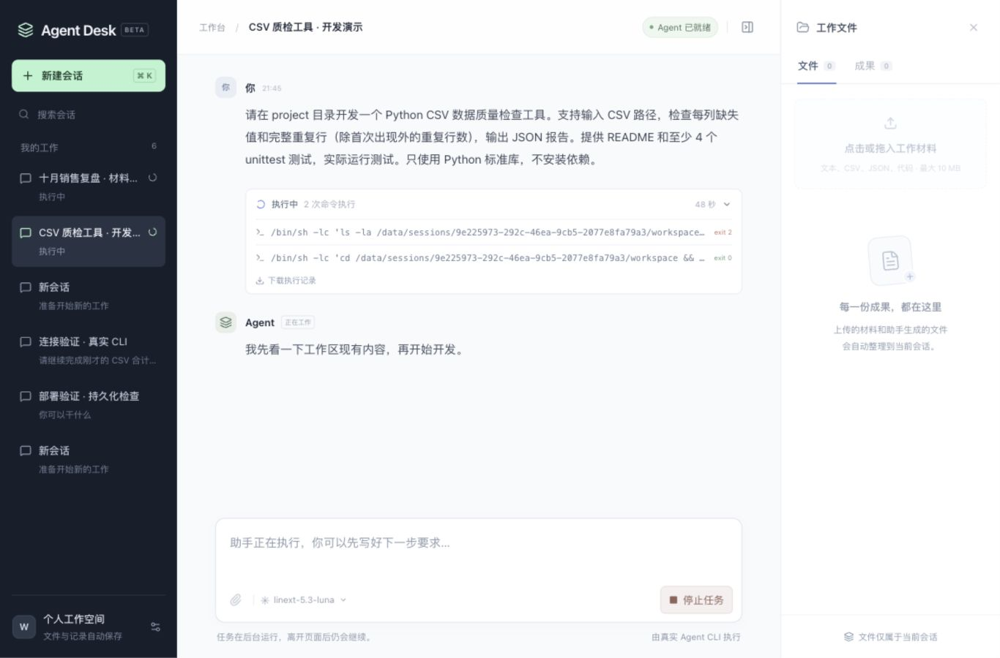
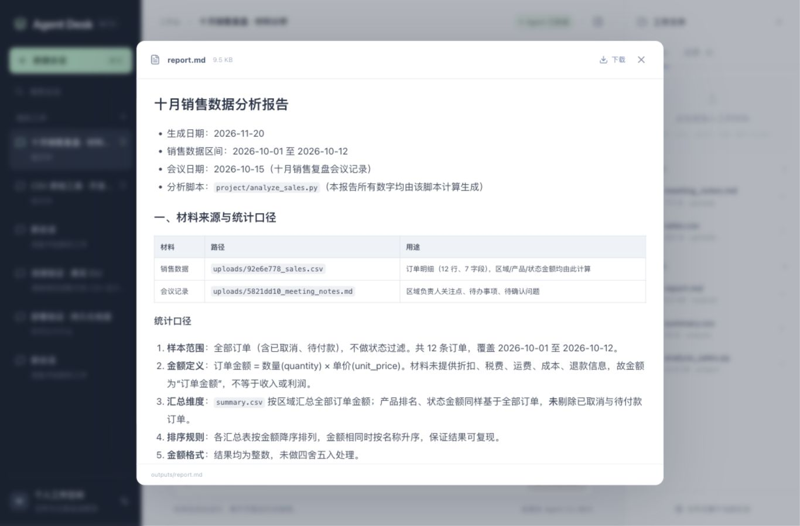
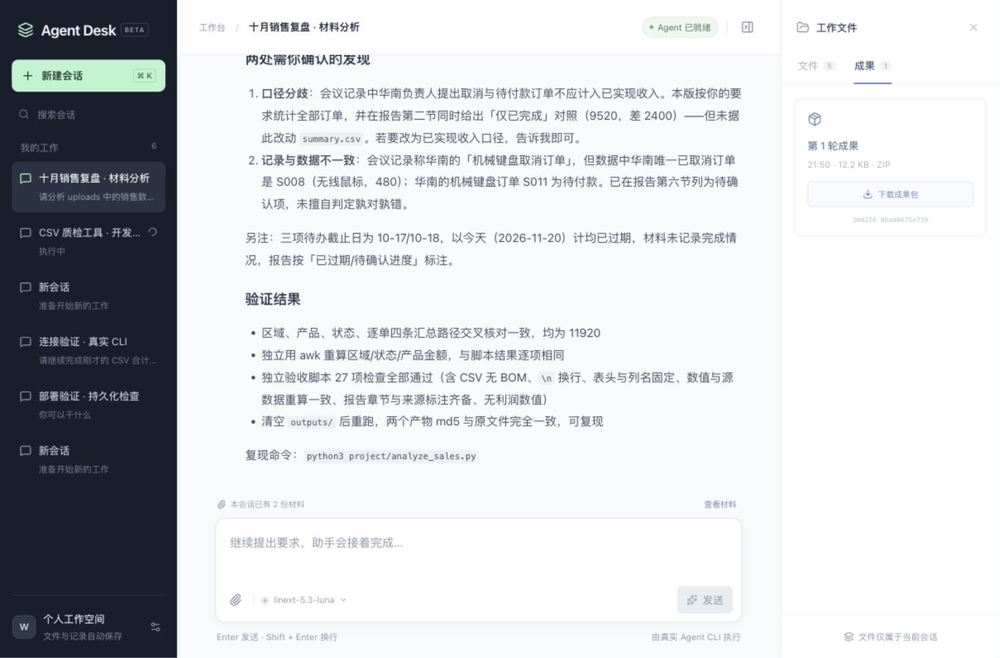
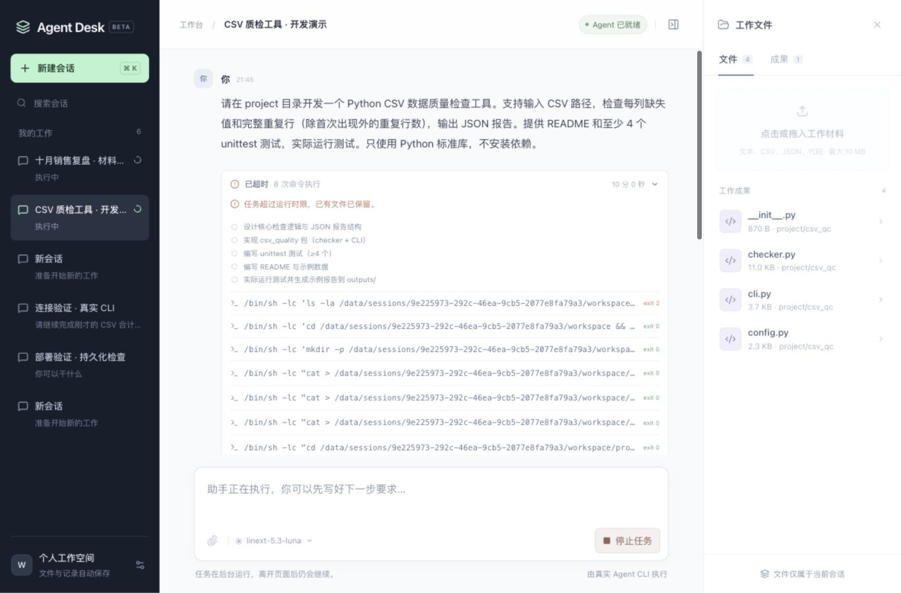
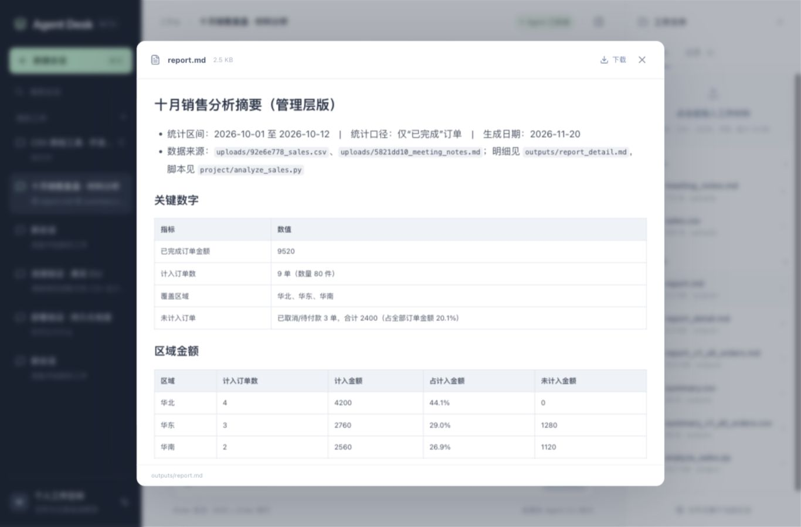
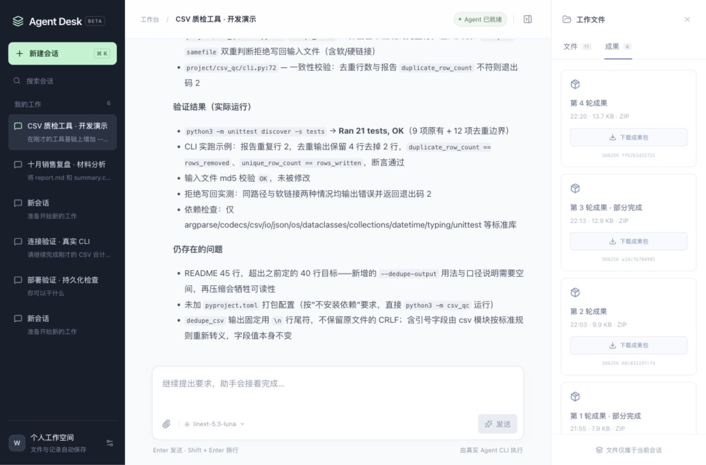

# 真实演示导览

演示日期：2026-11-20。运行入口为 Docker Compose 提供的 `http://localhost:8080`；真实引擎为 Codex CLI 0.114.0，平台模型为 `linext-5.3-luna`。输入材料全部为虚构数据。

## 1. 两个工作并行执行

左侧分别是代码开发会话和材料分析会话。命令、退出码和文件随执行更新。切换会话及刷新页面后，任务仍在后台继续。

## 2. 查看与获取材料分析结果

助手读取上传的销售 CSV、会议记录，实际执行 Python，生成 Markdown 报告和 CSV 汇总。

第一版区域金额独立核验为华东 4040、华北 4200、华南 3680，合计 11920。预期值由 `demo/verify_sales.py` 计算，没有交给 Agent。点击成果下载得到 ZIP，浏览器下载文件和 API 产物 SHA256 相同。

## 3. 超时与接续

代码首轮遇到上游输出长度限制，最终在 600 秒时限到达后中止。界面保留错误状态与已有代码，产生标记为部分成果的快照。在同一会话继续请求，CLI 使用原会话上下文继续工作。

此尝试保留在 `real/code_1-attempt-1-trace.json` 与对应成果 ZIP 中，未将超时记录改写为成功。

## 4. 在原会话修改统计口径

第二轮要求将报告与汇总表改为仅统计“已完成”订单。助手实际改动分析脚本并重新运行，报告压缩为管理层摘要，保留负责人、期限和材料来源。

独立 Decimal 核验：华东 2760、华北 4200、华南 2560，合计 9520。第一轮 11920 的快照仍可下载，不受第二轮覆盖工作文件影响。

## 5. 开发工具与追加去重

基础 CSV 工具在独立 Docker 沙箱中通过 9 项 unittest，另用 4 行独立数据核验缺失值与重复行。追加要求加入 `--dedupe-output`，并澄清空白字符不同的行不算重复。

去重版本在模型运行中暴露并修复了导出遗漏，随后全部 21 项测试通过。此次也到达原 600 秒时限，保留了部分成果；独立验收额外检查了精确重复、首行顺序、原文件 SHA256 不变和拒绝覆盖输入文件，全部通过。最终配置根据实测调整为 1200 秒，并在原会话续接成功结束。最终成果 ZIP 再次通过全部 21 项测试及独立断言。

## 6. 容器重启后继续访问

所有任务完成后执行 `docker compose restart app`，逐项比较重启前后的 CLI 会话 ID、消息哈希、任务状态、工作文件及 6 份成果 ZIP 的 SHA256，完全一致。刷新浏览器后会话与版本记录正常显示，控制台无 error。见 [重启核验](real/restart-verification.json)、[验收汇总](real/acceptance-summary.json)。

## 原始证据

- `real/*-trace.json`：真实 CLI 事件、工具命令、输出与状态。
- `real/*-session.json`：消息、CLI 会话 ID、run 及成果元数据。
- `real/*-artifacts.zip`：每次执行完成时的独立成果快照。
- `real/*-verification.json`：独立核验结果。
- `backend-tests.txt`：应用行为自动测试，使用明确标注的测试替身，和上述真实演示分开。
